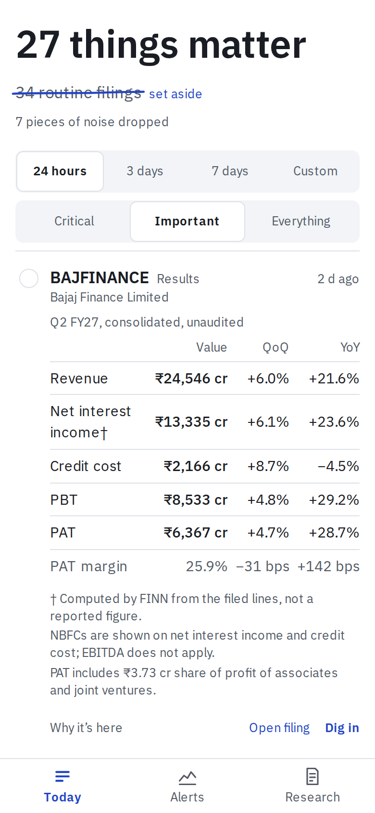
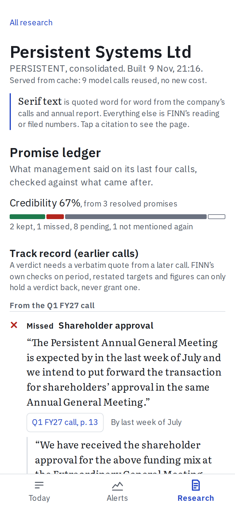
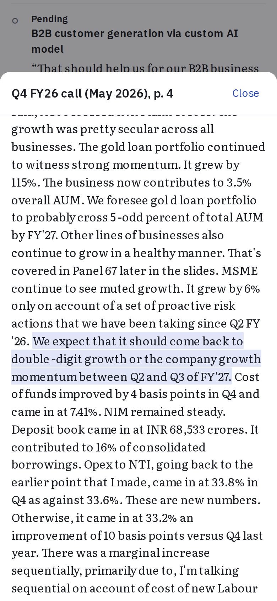

# FINN

FINN is a phone-first investing assistant for a portfolio of Indian listed companies.

- **Push.** It reads every NSE filing and tells you how many things actually matter today.
- **Pull.** It reads a company's last four earnings calls and its annual report, then checks what management promised against what happened.

**Live:** [finn-qx98.vercel.app](https://finn-qx98.vercel.app) (best on a phone; installable) · **API:** [finn-peach.vercel.app/health](https://finn-peach.vercel.app/health) · **Build history:** [`ai-history/`](ai-history/) · **Design:** [`docs/DESIGN.md`](docs/DESIGN.md) · **Evals:** [`docs/EVALS.md`](docs/EVALS.md)

<p>



</p>

## What it does

**Today** is a feed that ends.
- **Ranking.** Every filing for the 18 holdings is classified (rules first, an LLM for the rest) and scored. Related filings collapse into one story, and the screen says "N things matter".
- **The rest.** The routine filings are struck through and kept in a drawer.
- **Story cards.** Results get a Revenue, EBITDA, PBT and PAT grid with QoQ and YoY, computed from NSE's XBRL, not read by a model. Lenders get their own lines. Management changes get the person's profile, taken verbatim from the filing. Deals, fund-raises and litigation get a one-line brief with grounded facts.
- **Results meet promises.** Under a results grid, FINN shows the company's open promises from its own calls, quoted with call and page. When the quote names the same line, a pace sentence sets this quarter beside the target, for example "This quarter: revenue +21.6% YoY, above the 15–18% target. One quarter, not the full year." It never grades a promise. The dossier, in turn, shows the latest filed quarter under its ledger.
- **The end.** The feed closes with "You're caught up."

**Alerts.** You set the rules (a volume multiple, a price move, which filing types count, per-stock overrides). They live on your phone and go to the server with each request, so the server keeps no user state.

**Research** works for any NSE company. A dossier leads with the **Promise Ledger**:
- **Promises.** Every forward-looking statement from the last four calls, quoted verbatim with its page.
- **Grading.** Each promise is graded against the calls that followed: kept, partly, missed, pending, or not mentioned again.
- **Evidence.** A verdict needs a verbatim quote from a later call. Code checks then demote any verdict whose evidence is about another period, merely restates the target, or shows a figure below it.
- **The rest.** A snapshot of the business, a multi-year trajectory, balance-sheet health, and a cited bull and bear case.

Every claim carries a citation chip that opens the source page with the quote highlighted. Numbers FINN computed are labelled as computed, never shown as quotes.

## How it is built

```
NSE filings ──┐                         ┌─ POST /digest      (clustered, ranked, windowed)
NSE XBRL ─────┤                         ├─ POST /alerts      (rules sent by the phone)
Yahoo EOD ────┼─► refresh (daily) ─► SQLite snapshot ─┤─ GET /results/{sym}
screener.in ──┘   classify · enrich      (committed)  ├─ GET /research/{sym}
                  research builds                     └─ GET /research/{sym}/build  (SSE, live)
```

- **Backend.** Python 3.12, FastAPI, SQLite and httpx, deployed as a Vercel Python function.
  - The API serves a committed SQLite snapshot and copies it into `/tmp` on a cold start.
  - Only search and live research builds reach the network at request time.
  - A GitHub Actions job refreshes the snapshot every morning at 06:00 IST and commits it. Vercel redeploys from that commit.
- **Frontend.** Next.js, React 19 and Tailwind, installable as a PWA.
  - It uses no component or chart library.
  - A service worker keeps the last answers, so Today still opens offline.
- **Arithmetic never goes to a model.** QoQ, YoY, margins, CAGR, debt to equity, cash conversion and the ledger's computed grades are all Python.

### Models and cost

| Task | Model | Why |
|---|---|---|
| Filing classification (what rules miss), one-liners, people | Groq `openai/gpt-oss-120b`, reasoning medium | 91.3% vs 85.6% for the 20b model on the eval, about $0.001 per batch of 20 |
| Transcript guidance extraction | Gemini 3.5 Flash-Lite (3.1 Flash-Lite fallback) | Whole-transcript reads in one call |
| Ledger judgment, snapshot, bull and bear | Gemini 3.5 Flash (Flash-Lite fallbacks) | Caught misses that Flash-Lite labelled pending in a live A/B |
| Results numbers | none (NSE XBRL) | Filed numbers need no model |

- **Caching and the ledger.** Every LLM call is content-hash cached and logged in a cost ledger.
- **A dossier.** About 9 calls, built in 81 to 99 s, $0.03 to $0.07 at list price.
- **The backfill.** The 30-day push backfill cost $0.06 at list price.
- **Actual spend.** Everything ran on free tiers, so nothing was paid.

## Evals ([docs/EVALS.md](docs/EVALS.md))

- **Classification:** 91.3% overall and 87.0% on material categories, on a hand-labelled set of 104 filings. Rules alone score 85.6%.
- **Results numbers:** 68 of 70 metric pairs match screener for all 18 holdings. The 2 misses are EBITDA definitions, explained in EVALS.
- **Research citations:** 143 of 143 re-verified verbatim on their pages across 7 dossiers. The dossiers cover:
  - a bank (HDFCBANK);
  - an NBFC (BAJFINANCE);
  - a company with negative net worth (IDEA).
- **Ledger, hand audit:** before the verdict checks, 3 of 11 resolved verdicts were wrong. All three mistakes were mechanical, so code checks now catch them: after the checks, 0 of 8 are wrong and 3 are debatable. Most rows stay pending, for two reasons: a promise from the newest call has no later call to grade it, and many targets aren't due yet. EVALS breaks down why each one is pending.

## Deliberately left out

- Intraday data, broker research and news sentiment: the brief asks for primary sources.
- Accounts, logins and server-side user state: settings stay on the device.
- BSE as a filing source: its API refused automated clients.
- Portfolio P&L.

## Known limits

- **Live builds don't persist.** A live build of a new company is saved only on the server instance that ran it, until that instance recycles. The demo set lives in the committed snapshot.
- **Results vary between runs.** Extraction and judging run at the models' default temperature, so a rebuild can surface different promises.
- **3.5 Flash has no published price.** Its calls are counted but priced at $0, so dossier costs are understated.
- **NSE may refuse GitHub's runners.** If it does, `scripts/refresh.py` runs locally and the snapshot is committed by hand.

## Run it locally

```bash
# backend (Python 3.12+, uv)
cd backend
cp .env.example .env            # add GEMINI_API_KEY and GROQ_API_KEY
uv sync
uv run pytest -q                # 778 tests, no network
uv run uvicorn finn.api.main:app --reload --port 8000

# frontend (Node 22)
cd frontend
npm install
NEXT_PUBLIC_API_URL=http://localhost:8000 npm run dev
npm run test && npm run e2e     # vitest, then Playwright against fixtures
LIVE_URL=https://finn-qx98.vercel.app npx playwright test -c playwright.live.config.ts  # the deployed site
```

To refresh the data, run `uv run python scripts/refresh.py --days 3 --out seed/finn.sqlite`. To build dossiers, run `uv run python scripts/research.py PERSISTENT DIXON --out seed/finn.sqlite`.

## How this was built

FINN was built with Claude Code over one week, in five plans:
1. the push backend;
2. enrichment;
3. research;
4. the frontend;
5. deployment.

Each plan was written first and then executed test-first. Plans 1 to 3 ran with a fresh subagent per task and a reviewer after each task. Plan 4 ran inline with one final review. The plans are in `docs/superpowers/plans/`. The task ledgers, briefs, reviews and the redacted session transcripts are in `ai-history/`.
